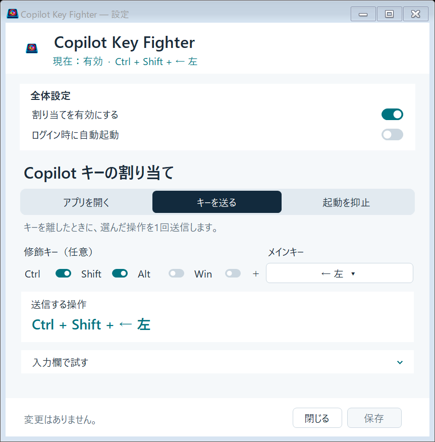
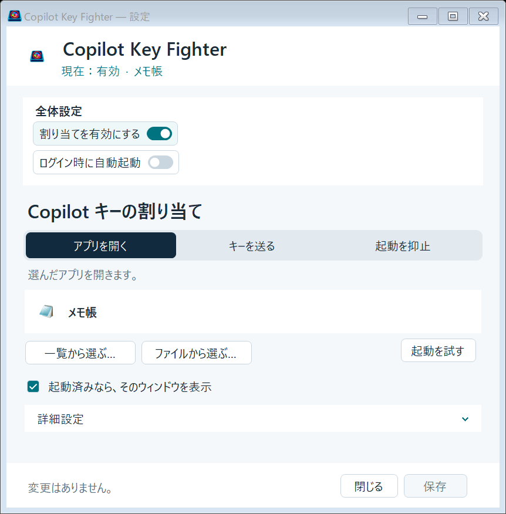
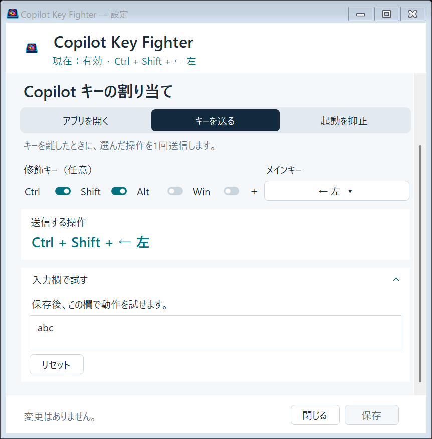

# Copilot Key Fighter

**Copilot キーを、自分の使いたいアプリやキー操作に変更する。**

Windows 11 の通知領域に常駐し、Copilot キーの標準の起動動作を抑えて、選んだ操作を実行します。ChatGPT に限らず、アプリ一覧や実行ファイルから起動先を指定できます。

| アプリを開く | キーを送る | 起動を抑止 |
| --- | --- | --- |
| 選んだアプリを起動。起動済みならウィンドウを表示 | Delete や Ctrl + Shift + ← などを送信 | Copilot キーの標準の起動動作を止める |

**ポータブル ZIP（インストール不要）**で配布します。Windows 11 x64 向けで、.NET の追加インストールや PowerToys は不要です。設定はアプリのフォルダーとは別に保存します。

## ダウンロードと初回設定

**注意：** 本アプリは未署名のため、Windowsの起動時にセキュリティ警告が表示される場合があります。

1. [GitHub Releases](https://github.com/Lye-0/Copilot-Key-Fighter/releases) から **`CopilotKeyFighter-<バージョン>-win-x64.zip`** をダウンロードします。`source.zip` は開発者向けのソースです。
2. ZIP を、使い続けるフォルダーに**すべて展開**します。例：`C:\Users\自分の名前\Apps\CopilotKeyFighter`。
3. 展開先の **`CopilotKeyFighter.exe`** を起動します。
4. 「Copilot キーの割り当て」で動作を選び、アプリまたはキーを指定します。
5. 「全体設定」の **「割り当てを有効にする」** をオンにし、右下の **「保存」** を押します。
6. Copilot キーを押して離し、指定した操作が実行されることを確認します。

初回は割り当て・自動起動ともにオフです。変更は「保存」で適用されます。設定画面を閉じても通知領域で動作を続けます。

## 設定画面の見方

右上の **About** から、現在の本体・設定ファイル・自動起動登録の場所と、導入・削除手順を確認できます。場所は実行環境から取得し、表示された場所は「コピー」ボタンでコピーできます。




| 場所 | できること |
| --- | --- |
| 製品名の下の「現在」 | 保存・適用済みの動作と、有効・停止・一時停止の状態を確認 |
| 全体設定 | 割り当ての有効化、ログイン時の自動起動を選択 |
| 3つの動作の切り替え | 「アプリを開く」「キーを送る」「起動を抑止」から1つを選択 |
| 動作ごとの設定欄 | 起動先のアプリや、送信するキーを指定 |
| 画面下部 | 未保存の変更を確認し、「保存」で適用 |

「詳細設定」「入力欄で試す」は、見出しをクリックすると内容を展開できます。以下の使い方も、見出しをクリックして開けます。

## 動作別の使い方

<details open>
<summary><strong>アプリを開く — アプリ一覧・実行ファイルから選ぶ</strong></summary>



1. 「アプリを開く」を選びます。
2. **「一覧から選ぶ…」** でアプリを検索して選択するか、**「ファイルから選ぶ…」** で `.exe` を指定します。
3. 選んだアプリ名を確認します。一覧から選んだ場合、必要なアプリIDは自動で取得します。
4. **「起動を試す」** で選択先を確認し、「保存」を押します。

「起動済みなら、そのウィンドウを表示」をオンにすると、既存ウィンドウの前面表示・最小化からの復元を優先します。毎回起動処理を実行したいツールなどではオフにできます。

「詳細設定」では、アプリIDの確認・コピー、AUMID の直接指定、起動引数、作業フォルダーを設定できます。利用できる項目はアプリの種類によって異なります。

「起動を試す」は、保存前でも現在選択しているアプリを実際に起動します。

</details>

<details>
<summary><strong>キーを送る — Delete やキーの組み合わせを割り当てる</strong></summary>

1. 「キーを送る」を選びます。
2. **「メインキー」** をクリックし、キー名で検索して選びます。
3. 必要なら **Ctrl / Shift / Alt / Win** をオンにします。複数を同時に選べます。
4. **「送信する操作」** の組み合わせを確認し、「保存」を押します。

Delete だけなら修飾キーはすべてオフにします。Ctrl + Shift + ← なら Ctrl と Shift をオンにし、「← 左」を選びます。枠で囲まれた各キーを「＋」でつないだ表示が、同時に送る組み合わせです。

Copilot キーを押して離すと、操作しているウィンドウへ1回送信します。途中で別のキーを操作したり、ウィンドウを切り替えたりすると、誤送信を防ぐため取り消します。

**Delete の動作確認：** 保存後に「入力欄で試す」を開き、「リセット」を押します。`abc` の先頭にカーソルが置かれるので、Copilot キーを押して離し、`bc` になることを確認します。



キー一覧は検索、ホイール、スクロールバーで探せます。

</details>

<details>
<summary><strong>起動を抑止 — Copilot キーで何も起動させない</strong></summary>

「起動を抑止」を選び、「割り当てを有効にする」をオンにして保存します。アプリ起動やキー送信を行わず、Copilot キーの標準の起動動作を止めます。

「割り当てを有効にする」をオフにするのとは異なります。オフの場合、本アプリによる抑止も停止します。

</details>

## 自動起動と日常の操作

<details>
<summary><strong>Windows へのログイン時に自動起動する</strong></summary>

1. exe を使い続ける場所に置き、起動します。
2. 設定画面の「全体設定」で **「ログイン時に自動起動」** をオンにします。
3. **「保存」** を押します。

次回ログインから、設定画面を開かずに通知領域へ常駐します。登録はアプリが行うため、ショートカット作成やレジストリ編集は不要です。

解除する場合は同じ項目をオフにして保存します。自動起動と割り当ての有効・無効は別の設定です。

</details>

<details>
<summary><strong>設定を開く・一時停止する・終了する</strong></summary>

タスクバーの通知領域にあるアプリアイコンを右クリックします。見つからなければ、隠れているインジケーターも確認してください。

| メニュー | 動作 |
| --- | --- |
| 設定… | 設定画面を開く。アイコンのダブルクリックでも開けます |
| アプリを開く | 保存した起動先を開く。アプリ起動モードで対象を指定したときに使えます |
| 一時停止 / 再開 | 保存した割り当てを残したまま、本アプリによるキー処理を停止・再開 |
| 終了 | 常駐を終了 |

設定画面の「閉じる」や「×」は、常駐の終了ではありません。一時停止中・終了後は、本アプリによる標準動作の抑止も停止します。「終了」だけでは自動起動登録は解除されません。

</details>

## 更新・移動・削除

<details>
<summary><strong>新しいバージョンに更新する</strong></summary>

1. 通知領域から「終了」を選びます。未保存の変更があれば、保存の要否を選んで終了します。
2. 新しい配布 ZIP を、同じフォルダーへ上書き展開します。
3. `CopilotKeyFighter.exe` を起動します。

設定は `%LOCALAPPDATA%\CopilotKeyFighter\settings.json` に保存するため、通常の更新では引き継がれます。自動更新機能はありません。

</details>

<details>
<summary><strong>アプリのフォルダーを移動する</strong></summary>

自動起動を使っている場合は、移動前に「ログイン時に自動起動」をオフにして保存します。常駐を終了し、フォルダーを移動してください。

移動先の exe を起動し、自動起動を再びオンにして保存すると、新しい場所が登録されます。

</details>

<details>
<summary><strong>アプリと設定を削除する</strong></summary>

1. 「ログイン時に自動起動」をオフにして「保存」を押します。
2. 通知領域から「終了」を選びます。
3. 展開したアプリのフォルダーを削除します。
4. 設定・診断情報も不要なら、エクスプローラーのアドレス欄に `%LOCALAPPDATA%\CopilotKeyFighter` と入力し、そのフォルダーも削除します。

本体を削除する前に、自動起動の解除を済ませてください。設定フォルダーは利用者ごとに保存され、ZIP の展開先には含まれません。

</details>

## 困ったとき・対応範囲

<details>
<summary><strong>Copilot キーを押しても動かない・別の画面も開く</strong></summary>

- 通知領域にアイコンがあり、設定画面の「現在」が「有効」になっているか確認します。
- 「保存」を押したか、一時停止していないか確認します。
- アプリ起動なら「起動を試す」、キー送信なら保存後の入力欄で設定を切り分けられます。
- PowerToys などで Copilot キーに別の割り当てを設定している場合、その割り当てを解除してください。CapsLock など別のキーの設定はそのまま利用できます。
- 旧 ChatGPTLauncher を使っていた場合は、旧版を終了し、旧版の自動起動も解除してください。

対応する入力は **Left Win + Left Shift + F23** を送る Copilot キーです。異なる入力を送る機種は対象外です。

</details>

<details>
<summary><strong>利用できる操作と制限</strong></summary>

- Windows 11 x64 向けです。
- Ctrl + Alt + Delete、修飾キー単独の長押し、マクロ、F23 への自己割り当ては対象外です。
- 管理者権限のアプリ、セキュアデスクトップ、一部ゲームの入力は対応を保証しません。
- アプリ固有の起動方式・共通ホストによって、既存ウィンドウを識別できない場合があります。
- Windows の前面化制限により表示できない場合は、前面化失敗だけを理由に既存アプリを重複起動しません。
- 設定を読み込めない場合は、割り当てを停止して設定画面を表示します。
- 初版にはインストーラー・自動更新・コード署名は含みません。

検証済みの範囲と未確認事項は [検証記録](docs/verification.md) を参照してください。

</details>

## 開発者向け

<details>
<summary><strong>ソースからビルドする・テストする</strong></summary>

Windows x64 と .NET 10 SDK が必要です。テストは実際のフックとホットキーを使用するため、先に本アプリと旧ランチャーを通知領域から終了してください。

```powershell
dotnet test tests/CopilotKeyFighter.Tests/CopilotKeyFighter.Tests.csproj -c Release
./scripts/package.ps1 -Version 0.1.0
```

`artifacts/` に self-contained / single-file の exe、README、画像、ライセンス等を含む ZIP と SHA256 を生成します。

GitHub Actions は push / pull request でテストとパッケージ生成を行います。`v0.1.0` 形式のタグでは、ZIP と対応するソース ZIP を添付したドラフト・プレリリースを作ります。公開前に実機チェックを完了してください。

</details>

## ライセンス

ソースコードは **MIT License** で公開しています。本文は [LICENSE](LICENSE)。バイナリに対応するソースとビルド手順は、同一バージョンのタグおよびソース ZIP で提供します。

本プロジェクトは Microsoft の公式製品ではありません。第三者のコンポーネント・マークについては [NOTICE.md](NOTICE.md) を参照してください。
